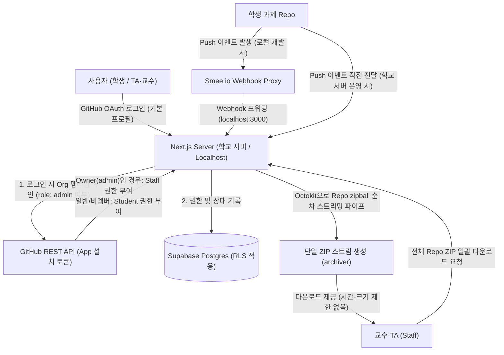

# RepoTrack 구현 계획

- 상태: **승인 및 변경사항 반영 (2026-10-26)** · 구현 미착수
- 요구사항 출처: Notion 문서 PDF 내보내기 `RepoTrack.pdf` (3페이지) + 추가 전달사항
- 작성 근거: Context7로 공식 문서 확인 (GitHub Docs, Supabase, Next.js 16.2)
  - 1. TA/교수는 GitHub Organization의 Owner(admin)로 권한이 지정되어 있음
  - 2. 학교 서버 보유 → Vercel 배포 불필요, 1차 검증은 localhost에서 진행 (Smee.io 웹훅 프록시 활용)
  - 3. README 검사는 교수가 지정한 대제목 키워드(Key Learning, Problem & Solution, Code Review, AI Usage, Reflection 등) 포함 여부로 판단

---

## 1. 목표

GitHub organization의 학생 과제 repo를 분석하는 웹서비스 **RepoTrack**을 구축한다.

- **학생**
  - GitHub 로그인 후 본인에게 배정된 repo만 확인
  - 제출 상태, 커밋 그래프, README 검사 결과 확인
- **TA·교수**
  - GitHub Organization의 Owner(admin) 계정으로 로그인 시 관리자 권한 자동 획득
  - 담당 과제의 전체 제출 현황 확인
  - 과제 기준 설정과 재검사
  - repo ZIP 일괄 다운로드 (학교 서버 기반 제한 없는 스트리밍)
- **순위표**
  - push webhook 기반, 새 과제만 대상
  - 부정확한 순위는 표시하지 않음
- **운영 원칙**
  - 유료 AI API 미사용 (README는 대제목 키워드 매칭 규칙 기반)
  - 학교 서버(Node.js / Docker) 자체 호스팅 및 localhost 테스트
  - **학생이 다른 학생의 비공개 repo 데이터를 볼 수 없어야 한다**

### 1.1 요구사항 요약 (원문 + 추가 피드백 기준)

| 절 | 핵심 요구사항 |
|---|---|
| 1. 흐름 | org repo에 push → GitHub 로그인 → 본인 repo 목록 → [분석하기] → 제출 상태, 커밋 그래프, README 결과 |
| 2. 권한 | **TA·교수는 GitHub Org Owner로 자동 판별 (`role: staff`)** / 학생: 본인 repo, 개인 분석 결과, 순위표 |
| 3. 과제 설정 | 과제명, 마감 시각(KST), 분석 브랜치, 필수 파일·코드 조건, **README 필수 대제목 키워드 목록** |
| 4. 학생 화면 | 과제 목록과 제출 상태, 분석하기, 개인 대시보드, 새로고침, 순위표 |
| 5. 관리자 화면 | 인원 현황, 학생별 충족 여부, README 항목별 현황, 커밋 기록, 갱신 시각과 오류, **단일 ZIP 일괄 스트리밍 다운로드**, 기준 수정 후 재검사 |
| 6. 순위표 | 새 과제: 조건을 처음 모두 만족한 시각 기준 순위 / 진행 중이거나 끝난 과제: 순위 없이 현황만 |
| 7. 갱신·운영 | DB 결과 우선 표시, 24시간 경과 시 오래된 데이터로 처리, 수동 새로고침 쿨다운, push 알림을 받으면 갱신 대상으로 표시 |
| 8. 배포 환경 | **학교 서버(Node.js / Docker) 배포 & localhost 개발 (Smee.io 프록시로 Webhook 테스트)** |

---

## 2. 현재 구조 분석

2026-10-26 기준 저장소 상태:

```
Webservice_Tool/
├── .agents/mcp_config.json   # MCP 설정 (context7, playwright, sequential-thinking, shadcn)
├── .git/                     # main 브랜치, 커밋 없음
├── .idea/, untitled.iml      # IntelliJ 프로젝트 파일 (GENERAL_MODULE, 소스 설정 없음)
├── AGENTS.md                 # 개발 계획 작성 및 저장 규칙
└── docs/plans/repotract-plan.md # 이 계획 파일
```

- 애플리케이션 코드, `package.json`, DB 스키마가 **전혀 없는 신규 프로젝트**다.
  - 기존 코드와의 호환성이나 마이그레이션은 고려하지 않아도 된다.
- `.gitignore`가 아직 없다.
  - 구현 착수 시 `.env*`, `node_modules`, `.next`, `.idea` 등을 제외하도록 최우선 생성하여 비밀키 커밋을 방지한다.
- MCP 활용 계획
  - Context7: 공식 라이브러리 스펙 확인 (완료)
  - shadcn: UI 컴포넌트 추가 시 활용
  - Playwright: 구현 후 브라우저 E2E 검증 시 활용

---

## 3. 기술 스택 및 호스팅 검토

| 구성 | 판단 | 근거 및 구현 상세 |
|---|---|---|
| Next.js App Router + TypeScript | 채택 | Route Handler로 webhook, ZIP, 분석 API 처리. self-hosted Node.js 환경에서 `after()` 지원 |
| Tailwind CSS + shadcn/ui | 채택 | shadcn Chart(Recharts 기반)로 대시보드 커밋 시각화 |
| Recharts | 채택 | 날짜별 커밋 막대그래프 |
| Supabase Postgres + Auth(GitHub) | 채택 | GitHub OAuth, RLS 지원. 무료 500MB DB |
| GitHub App + Octokit | 채택 | 설치 토큰(1시간 만료), Org 멤버십 조회(`GET /orgs/{org}/memberships/{user}`)로 Owner 판별 |
| **호스팅: 학교 서버 (Self-Hosted)** | **확정** | Vercel의 4.5MB 제한, 300초 타임아웃, 비상업 라이선스 이슈 완전 해소 |
| **로컬 테스트: Smee.io** | **확정** | Localhost 개발 시 GitHub push webhook 수신을 위한 공식 프록시 클라이언트 활용 |

---

## 4. 아키텍처 및 권한 흐름



---

## 5. GitHub 인증 및 관리자(Org Owner) 자동 판별

### 5.1 GitHub App 설정
- **Organization Permissions**:
  - `Members`: Read-only (Org 내 사용자 역할이 `admin`인지 판별하기 위함)
- **Repository Permissions**:
  - `Contents`: Read-only (소스 파일 트리, README, 커밋 내역, zipball 다운로드)
  - `Metadata`: Read-only
- **Subscribe events**:
  - `Push`

### 5.2 로그인 및 역할 자동 판정 흐름
1. 사용자가 Supabase Auth GitHub OAuth로 로그인한다.
   - 학생에게 `read:org` 같은 과도한 스코프를 요구하지 않는다 (기본 `read:user`, `user:email`만 요청).
2. OAuth 콜백(`/auth/callback`)에서 로그인한 유저의 GitHub username(`github_login`)을 확인한다.
3. 서버는 **GitHub App 설치 토큰**으로 GitHub API를 호출한다:
   - `GET /orgs/{TARGET_ORG}/memberships/{username}`
4. 판별 결과에 따른 역할 부여:
   - `role === 'admin'`: Organization의 Owner이므로 `profiles.role = 'staff'`로 upsert.
   - `role === 'member'` 또는 비소속: `profiles.role = 'student'`로 upsert.
5. TA와 교수는 별도의 수동 DB 설정 없이 GitHub Org Owner 계정으로 로그인하기만 하면 즉시 관리자 권한을 부여받는다.

---

## 6. 과제별 README 대제목 키워드 커스텀 설정 및 검사 엔진

### 6.1 과제별 README 키워드 동적 설정 UI 및 규칙
교수/관리자가 과제를 생성하거나 기준을 수정할 때, **과제마다 포함되어야 하는 Markdown 대제목 키워드 목록을 자유롭게 직접 지정**할 수 있다.

1. **관리자 UI (`/admin/assignments/[id]/criteria`)**:
   - Tag/Chip 형태의 키워드 입력 필드 제공 (Enter 또는 쉼표로 새 키워드 추가, `x`로 삭제).
   - **"기본 주간 리포트 템플릿 불러오기" 버튼**:
     - 클릭 시 교수님이 제시한 5대 키워드(`Key Learning`, `Problem & Solution`, `Code Review`, `AI Usage`, `Reflection`)를 한 번에 자동 입력.
   - 과제 성격에 따라 자유롭게 변경 가능 (예: 프로젝트 과제의 경우 `Architecture`, `API Specification`, `Troubleshooting` 등으로 지정 가능).
2. **저장 구조 (`criteria_versions.rules`)**:
   ```json
   {
     "branch": "main",
     "requiredFiles": [
       { "type": "glob_exists", "pattern": "src/**/*", "label": "src/ 소스 파일 존재" }
     ],
     "readme": {
       "required": true,
       "headerKeywords": [
         "Key Learning",
         "Problem & Solution",
         "Code Review",
         "AI Usage",
         "Reflection"
       ]
     }
   }
   ```

### 6.2 키워드 검사 판정 로직 (`src/lib/analysis/readme.ts`)
1. README 원문에서 Markdown 헤더 라인(`#`, `##`, `###`, `####`) 및 콜론 앞의 주요 라벨(`**Keyword**:` 등)을 추출한다.
2. 대소문자 무시(case-insensitive) 및 특수문자/공백 정규화 후, 해당 과제의 `rules.readme.headerKeywords`에 정의된 키워드들과 대조한다.
3. 판정 규칙:
   - **해당 과제에 설정된 대제목 키워드가 README에 포함되어 있지 않으면 해당 항목 미충족으로 판정한다.**
   - 지정된 모든 키워드가 존재해야 `readme.allSatisfied = true`가 된다.
   - 키워드가 아예 지정되지 않은 과제의 경우 README 파일 존재 여부만으로 통과 처리된다.
4. 결과 구조:
   ```json
   {
     "satisfied": false,
     "missingKeywords": ["Code Review"],
     "details": [
       { "keyword": "Key Learning", "found": true },
       { "keyword": "Problem & Solution", "found": true },
       { "keyword": "Code Review", "found": false },
       { "keyword": "AI Usage", "found": true },
       { "keyword": "Reflection", "found": true }
     ]
   }
   ```
5. 학생 대시보드에서는 해당 과제에 지정된 키워드 목록이 동적 체크리스트로 표시되어 어떤 항목이 충족되었고 어떤 항목이 누락되었는지 즉시 파악할 수 있다.

---

## 7. Localhost 개발 및 Webhook 수신 (Smee.io)

### 7.1 로컬 개발 환경
- GitHub webhook은 공인 IP/도메인이 없는 `localhost:3000`으로 직접 전송할 수 없다.
- GitHub 공식 오픈소스 도구인 **Smee.io**를 활용한다.
  1. `https://smee.io/new`에서 새 채널 생성 (예: `https://smee.io/xyz123`).
  2. GitHub App의 Webhook URL에 해당 Smee URL 등록.
  3. 로컬에서 Smee 클라이언트를 실행하여 들어오는 이벤트를 로컬 서버로 전달:
     ```bash
     npm run webhook:proxy
     # 내부 실행: smee --url https://smee.io/xyz123 --path /api/webhooks/github --port 3000
     ```
- 학교 서버 배포 시에는 서버의 도메인(예: `https://repotrack.univ.ac.kr/api/webhooks/github`)으로 GitHub App Webhook URL을 설정하면 프록시 없이 직접 수신한다.

---

## 8. 학교 서버 기반 ZIP 일괄 스트리밍 다운로드

### 8.1 Vercel 대비 개선점
- Vercel의 4.5MB 응답 한도와 300초 타임아웃이 없으므로, 번거로운 분할 다운로드(part 1, part 2...) 없이 **하나의 완성된 ZIP 아카이브로 일괄 다운로드**를 지원한다.

### 8.2 스트리밍 파이프라인 설계
- `GET /api/admin/assignments/{id}/archive`
- 관리자 권한(`staff`) 확인 후 실행.
- Node.js `archiver`를 사용하여 HTTP Response 스트림에 직접 파이프 연결 (`Transfer-Encoding: chunked`).
- 메모리에 전체 파일을 올리지 않고, 학생 repo마다 GitHub `GET /repos/{o}/{r}/zipball/{branch}` 스트림을 받아 아카이브 내에 `{학번}_{이름}_{repo}.zip`으로 압축 해제 없이(STORE) 순차 파이핑.
- 아카이브 루트에 `manifest.csv` 동봉 (학생 정보, 제출 여부, 커밋 SHA, 다운로드 결과 기록).

---

## 9. 데이터 구조 (Supabase Postgres)

| 테이블 | 주요 컬럼 | 비고 |
|---|---|---|
| `profiles` | `id`(=auth.uid), `github_id` unique, `github_login`, `role`(`student`/`staff`) | 로그인 시 Org Owner 판별로 role 자동 upsert |
| `roster` | `assignment_id`, `github_id`/`github_login`, `student_no`, `name` | 학생 명단 사전 등록 |
| `assignments` | `title`, `deadline_at`, `branch`, `ranking_mode`(`live`/`none`), `ranking_started_at`, `current_criteria_version_id` | 과제 기본 정보 |
| `criteria_versions` | `assignment_id`, `version`, `rules` jsonb, `created_by`, `created_at` | README 키워드 및 파일 조건 스냅샷 |
| `student_repos` | `assignment_id`, `github_id`, `repo_id`, `full_name`, unique(`assignment_id`,`github_id`) | 학생과 repo 매핑 |
| `push_events` | `delivery_id` unique, `repo_id`, `ref`, `after_sha`, `pushed_at`, `status`, `attempts`, `error` | 중복 방지 및 웹훅 큐 |
| `snapshots` | `student_repo_id`, `commit_sha`, `observed_at`, `source`, `tree_paths` text[], `readme_text`, `commit_count` | 재검사용 스냅샷 |
| `evaluations` | `snapshot_id`, `criteria_version_id`, `submitted`, `file_results`, `readme_results` | 판정 기록 |
| `commits` | `student_repo_id`, `sha`, `committed_at`, `author_login` | 그래프용 커밋 내역 |
| `repo_status` | `student_repo_id` PK, `latest_snapshot_id`, `fetched_at`, `stale`, `last_error`, `first_satisfied_at`, `manual_refresh_at` | 대시보드 메인 조회용 |

---

## 10. 개인정보 접근 통제 (학생 간 비공개 repo 노출 방지)

1. **IDOR 방지**: API는 클라이언트가 전달하는 임의의 `owner/repo` 문자열을 받지 않으며, 오직 `student_repo_id`를 검증하여 세션 유저의 소유인지 서버에서 대조한다.
2. **Supabase RLS 완비**:
   - `student_repos`, `evaluations`, `snapshots`는 본인 소유이거나 `profiles.role = 'staff'`인 경우에만 SELECT 허용.
   - `snapshots.readme_text` 등 원문 데이터는 학생 클라이언트의 직접 SELECT를 차단하고 서버 렌더링 시에만 내부 조회.
3. **순위표 정보 최소화**: `get_leaderboard` RPC는 순위, GitHub 아이디, 최초 충족 시각만 반환하며 repo 이름이나 소스 파일 경로는 일절 노출하지 않는다.

---

## 11. 수정 대상 파일

| 영역 | 파일 | 역할 |
|---|---|---|
| 설정 | `.gitignore`, `package.json`, `tsconfig.json`, `next.config.ts`, `.env.example` | 프로젝트 설정, smee-client, archiver |
| DB | `supabase/migrations/0001_schema.sql`, `0002_rls.sql`, `0003_rpc.sql` | 스키마, RLS, 순위표 RPC |
| 인증 | `src/middleware.ts`, `src/app/auth/callback/route.ts`, `src/lib/auth/guards.ts` | Org Owner 감지 및 `role: staff` 부여 |
| GitHub | `src/lib/github/app.ts` | Octokit App, Org 멤버십 조회 (`checkIsOrgOwner`) |
| GitHub | `src/lib/github/fetch-snapshot.ts` | 파일 트리, README, 커밋 조회 |
| GitHub | `src/lib/github/webhook.ts` | HMAC 서명 검증 |
| 분석 | `src/lib/analysis/readme.ts` (+ `readme.test.ts`) | **README 대제목 키워드 매칭 엔진** |
| 분석 | `src/lib/analysis/evaluate.ts` (+ `evaluate.test.ts`) | 종합 제출 여부 판정 순수 함수 |
| ZIP | `src/lib/archive/stream-zip.ts` | Node.js 기반 단일 ZIP 스트리밍 파이프라인 |
| API | `src/app/api/webhooks/github/route.ts` | Webhook 수신 엔드포인트 |
| API | `src/app/api/repos/[studentRepoId]/analyze/route.ts` | 수동 분석/새로고침 |
| API | `src/app/api/admin/assignments/[id]/archive/route.ts` | 관리자 단일 ZIP 스트리밍 다운로드 |
| 학생 UI | `src/app/(student)/page.tsx`, `repos/[studentRepoId]/page.tsx` | 과제 목록, 대시보드(Recharts) |
| 관리자 UI | `src/app/(admin)/admin/assignments/page.tsx`, `[id]/page.tsx` | 관리자 현황, 기준 설정, ZIP 다운로드 |

---

## 12. 구현 순서 (체크리스트)

### 0단계: 환경 셋업 및 Webhook 연동 확인
- [x] `.gitignore` 생성 및 Next.js 15+, TypeScript, Tailwind 설정 완료
- [x] `smee-client` 설치 및 `npm run webhook:proxy` 설정 완료
- [x] Smee.io를 통한 로컬 웹훅 수신 파이프라인 구성

### 1단계: Supabase 스키마 및 Org Owner 인증
- [x] DB 테이블(`0001_schema.sql`), RLS 정책(`0002_rls.sql`), RPC(`0003_rpc.sql`) 마이그레이션 작성 완료
- [x] GitHub OAuth 로그인 연동 및 GitHub App `GET /orgs/{org}/memberships/{username}` 기반 Org Owner 자동 감지(`role: staff`) 구현 완료

### 2단계: README 키워드 검사 및 분석 엔진
- [x] `readme.ts` 대제목 키워드 파서 구현 및 Vitest 단위 테스트 통과 (Weekly Report 5대 키워드 검증)
- [x] `evaluate.ts` 판정 순수 함수 및 24시간 캐시/5분 쿨다운 로직(`run-analysis.ts`) 구현 완료

### 3단계: 학생 대시보드 및 관리자 화면
- [x] 학생 화면: 과제 목록(`dashboard`), 개별 과제 대시보드(분석하기, 새로고침, README 키워드 체크리스트, Recharts 커밋 추이)
- [x] 관리자 화면: 과제 목록(`admin`), 새 과제 등록(`admin/assignments/new`), 과제별 현황판 및 과제별 README 키워드 커스텀 폼(`CriteriaForm` - 5대 템플릿 원클릭 지원)

### 4단계: Push Webhook 및 순위표
- [x] Push webhook 수신(`/api/webhooks/github`), HMAC SHA256 서명 검증, 멱등성 큐 기록 및 `after()` 비동기 백그라운드 분석 파이프라인
- [x] 새 과제 실시간 순위표(`get_leaderboard` RPC) 및 순위 없는 과제 현황 화면(`/assignments/[id]/leaderboard`)

### 5단계: 관리자 단일 ZIP 스트리밍 다운로드
- [x] Node.js `archiver` 기반 메모리 부하 없는 단일 ZIP 스트리밍 다운로드(`/api/admin/assignments/[id]/archive`) 및 `manifest.csv` 동봉 구현 완료

### 6단계: 검증
- [x] 단위 테스트 통과 (Vitest 8개 테스트 Pass)
- [x] Next.js 프로덕션 빌드 통과 (`npm run build` 정적/동적 라우트 컴파일 완료)

### 7단계: Organization Owner 자동 판별 고도화 및 관리자 편의성 개선 (완료)
- [x] OAuth 로그인 시 `read:org` 스코프 추가 (`src/app/login/page.tsx`)
- [x] 사용자 OAuth 토큰(`provider_token`) 기반 Org Owner 판별 함수 구현 (`src/lib/github/app.ts`)
- [x] OAuth 콜백에서 사용자 토큰 우선 검증 및 `staff` 자동 부여 + 관리자 자동 리다이렉트 (`src/app/auth/callback/route.ts`)
- [x] 대시보드(`src/app/dashboard/page.tsx`)에 관리자 과제 바로가기 카드 제공
- [x] 관리자 과제 상세(`src/app/admin/assignments/[id]/page.tsx`)에 학생 Repo 추가/동기화 UI 및 API 구현
- [x] 빌드 및 테스트 재검증 (Vitest 8/8 통과, Next.js 프로덕션 빌드 성공)

### 8단계: Organization 275개 Repo 자동 분류·검색 및 관리자 기능 전수 완성 (완료)
- [x] `.env.local`의 `GITHUB_APP_PRIVATE_KEY`를 실제 다운로드된 정식 RSA 키로 동기화
- [x] 저장소 이름 규칙(`assign01_학번` 등) 파서 및 단위 테스트 작성 (`src/lib/github/repo-parser.ts`, `repo-parser.test.ts`)
- [x] Org 저장소 전체(275개) 조회 및 과제별 자동 그룹화 API 구현 (`src/app/api/admin/org-repos/route.ts`)
- [x] 선택 과제 카테고리(assign01 등) 학생 Repo 일괄 등록 API 구현 (`src/app/api/admin/org-repos/import/route.ts`)
- [x] 과제 내 전체 학생 Repo 일괄 분석/재평가 트리거 API 구현 (`src/app/api/admin/assignments/[id]/batch-analyze/route.ts`)
- [x] 관리자 대시보드(`src/app/admin/page.tsx`)에 Org 저장소 실시간 검색 및 카테고리 탐색기 UI (`src/components/admin/org-repo-browser.tsx`) 연동
- [x] 과제 상세 화면(`src/app/admin/assignments/[id]/page.tsx`)에 "전체 일괄 재평가" 버튼 연동
- [x] Vitest 단위 테스트(12/12) 및 Next.js 프로덕션 빌드 검증 완료

### 9단계: 과제 상세 PostgREST 조인 오류 해결 및 GitHub 계정 선택 로그인 지원 (완료)
- [x] `src/app/admin/assignments/[id]/page.tsx` 외래키 모호성(`criteria_versions`) 및 스냅샷 경유 조인(`snapshots:latest_snapshot_id`) 수정 완료
- [x] `src/app/admin/page.tsx` 및 `src/app/dashboard/page.tsx`의 `repo_status` 조인 쿼리 정규화 완료
- [x] `src/app/login/page.tsx` GitHub OAuth 옵션에 `queryParams: { prompt: "select_account" }` 및 안내 추가 완료
- [x] 단위 테스트(12/12) 및 Next.js 프로덕션 빌드 검증 완료 (과제 상세 33개 학생 정상 로드 확인)

### 10단계: 학생 목록 '분석하기' 일괄 평가 버튼 연동 및 필수 조건/README 키워드 상세 화면 개선 (완료)
- [x] `src/lib/analysis/evaluate.ts`에 `rules.readmeKeywords` 및 `rule.description` 호환 지원 추가 완료
- [x] `src/lib/analysis/run-analysis.ts` 및 `batch-analyze/route.ts`에 쿨다운 바이패스(`bypassCooldown: true`) 추가 완료
- [x] `src/app/admin/assignments/[id]/page.tsx` 학생 목록 테이블 헤더의 `+ 학생 Repo 등록` 왼쪽에 `[분석하기]` 버튼 재배치 완료
- [x] `src/components/admin/batch-analyze-button.tsx` 버튼 UI를 `[▷ 분석하기]`로 변경하고 로딩 인디케이터 개선 완료
- [x] `src/app/dashboard/[studentRepoId]/client-view.tsx` 필수 조건 라벨 표시 및 README 5대 키워드 체크리스트 시각화 개선 완료
- [x] 단위 테스트(13/13) 및 Next.js 프로덕션 빌드 검증 완료

### 11단계: 일괄 분석(Batch Analyze) 런타임 오류 해결 및 현황표 컬럼 8종 개편 (완료)
- [x] `src/lib/github/fetch-snapshot.ts`에 빈 저장소(`size=0`) 안전 처리 및 `master` 브랜치 자동 fallback 추가 완료
- [x] `src/app/api/admin/assignments/[id]/batch-analyze/route.ts`에 `source: "manual"`로 변경하여 `snapshots_source_check` 제약 위반 해결 완료
- [x] `src/app/admin/assignments/[id]/page.tsx` 학생 현황표 컬럼 8종(학번, 이름, REpository, 제출 여부, commit갯수, README 충족 여부, 마지막 PUSH 시간, 상세) 개편 완료
- [x] 단위 테스트(13/13) 및 Next.js 프로덕션 빌드 검증 완료

### 12단계: REpository 하이퍼링크, README 리스트 키워드 인식 확장, 제출 여부 기준 개편 (완료)
- [x] `src/lib/analysis/readme.ts`: 불릿 리스트(`-`, `*`, `+`) 및 번호 리스트(`1.`, `2.`, `1)`, `2)`) 뒤 키워드 및 리스트 내 볼드체(`- **Key Learning**:`) 인식 로직 추가 완료
- [x] `src/lib/analysis/readme.test.ts`: 리스트 문법 키워드 매칭 단위 테스트 추가 완료 (15/15 전체 통과)
- [x] `src/app/admin/assignments/[id]/page.tsx`:
  - `REpository` 컬럼 클릭 시 GitHub 저장소 새 창 열기(`target="_blank"`) 및 `ExternalLink` 아이콘 적용 완료
  - `제출 여부` 컬럼 및 통계 바 집계를 커밋 push 여부(`commitCount > 0`) 기준으로 변경 완료 (`제출` / `미제출`)
- [x] Next.js 프로덕션 빌드 검증 완료

### 13단계: 한글 입력 중복 방지, 일괄 분석 실시간 진행률 스트리밍, README 키워드 기본값 빈 목록화 (완료)
- [x] `src/components/admin/criteria-form.tsx`:
  - `onKeyDown`에 `if (e.nativeEvent.isComposing) return;` 방어 적용 (한글 끝 글자 분리 중복 버그 원천 해결)
  - 기본 키워드 목록 `[]`로 초기화 및 `기본 Weekly Report 5대 키워드 불러오기` 버튼 제거
- [x] `src/app/api/admin/assignments/route.ts` & `src/app/api/admin/org-repos/import/route.ts`: 신규 과제 생성 시 기본 키워드 `[]`로 변경 완료
- [x] `src/app/api/admin/assignments/[id]/batch-analyze/route.ts`: `ReadableStream` NDJSON 실시간 분석 진행률 스트리밍 완료
- [x] `src/components/admin/batch-analyze-button.tsx`: 스트림 리더 수신 및 `4/33개 분석 완료...` 실시간 텍스트 표시 구현 완료
- [x] 단위 테스트(15/15) 및 Next.js 프로덕션 빌드 검증 완료

### 14단계: 콤마(,) 구분 키워드 일괄 등록, 저장 버튼 위치 재배치, README 통과 개수(n/m개) 표시 (완료)
- [x] `src/components/admin/criteria-form.tsx`:
  - `handleAddKeyword`에서 콤마(`,`) 구분자 파싱 및 일괄 등록 로직 구현 완료
  - 상단 헤더의 `새 버전으로 저장` 버튼을 `+ 추가` 버튼 바로 오른쪽으로 재배치 완료
- [x] `src/app/admin/assignments/[id]/page.tsx`:
  - `README 충족 여부` 컬럼에 `3/3개 통과`, `1/3개 통과`, `0/3개 통과` 등의 형식으로 통과 개수 표시 구현 완료
- [x] 단위 테스트(15/15) 및 Next.js 프로덕션 빌드 검증 완료

### 15단계: assign08_midterm 자동 분류, 과제 최신순 정렬, 관리자 순위표 연동 및 개선 (완료)
- [x] `src/lib/github/repo-parser.ts` & `repo-parser.test.ts`: `assign08_midterm` 패턴 지원 및 `과제 8차 중간고사 (assign08_midterm)` 라벨 생성 완료
- [x] `src/app/api/admin/org-repos/route.ts`: 카테고리 최신순(내림차순: 8차 -> 7차 -> ... -> 1차) 정렬 적용 완료
- [x] `src/app/admin/assignments/[id]/page.tsx` & `src/app/admin/page.tsx`: 관리자 `[🏆 순위표]` 바로가기 버튼 추가 완료
- [x] `src/app/assignments/[id]/leaderboard/page.tsx`: 미로그인 학생 누락 방지 및 순위표 조회 폴백 보강, 관리자 뒤로가기 링크 추가 완료
- [x] 단위 테스트(16/16) 및 Next.js 프로덕션 빌드 검증 완료

### 16단계: 기준 커밋 수(minCommits) 설정, 현황표 (실제/기준) 표시, 순위표 1·2·3등 포디움 배치 (완료)
- [x] `src/components/admin/criteria-form.tsx`: 기준 커밋 수(`minCommits`) 입력 필드 추가 및 저장 로직 연동 완료
- [x] `src/lib/analysis/evaluate.ts` & `src/lib/analysis/run-analysis.ts`: `minCommits` 조건 평가 및 `first_satisfied_at` 달성 시간 기록 보강 완료
- [x] `src/app/admin/assignments/[id]/page.tsx`: 현황표 `commit 갯수` 컬럼에 `(실제 커밋수 / 기준 커밋수)` 형식 표시 완료 (충족: 초록색, 미달: 주황색)
- [x] `src/app/assignments/[id]/leaderboard/page.tsx`: 3대 조건 완벽 충족자 대상 1위(🥇), 2위(🥈), 3위(🥉) 상단 명예의 전당 포디움 및 랭킹 정렬 구현 완료
- [x] 단위 테스트(17/17) 및 Next.js 프로덕션 빌드 검증 완료

### 17단계: 학생 학번(22300XXX) 기반 Organization 과제 Repo 매칭 및 대시보드 연동 (완료)
- [x] `src/lib/student/sync-student-repos.ts`: 학생 학번 자동 추론(`resolveStudentNo`) 및 Organization 내 학번 일치 Repo 동기화(`syncReposForStudent`) 구현 완료
- [x] `src/app/api/student/student-no/route.ts` & `src/components/student/student-no-banner.tsx`: 학번 등록/변경/동기화 API 및 학생 대시보드 상단 배너 구현 완료
- [x] `src/lib/auth/guards.ts` & `src/app/api/admin/org-repos/import/route.ts`: 학번 기반 소유권 확인 및 `profile_id` 자동 연결 완료
- [x] `src/app/dashboard/page.tsx` & `src/app/dashboard/[studentRepoId]/client-view.tsx`: 본인 학번과 일치하는 과제 Repo 최신순(`assign08_midterm` -> `assign07` -> ...) 표시 및 GitHub 외부 링크 추가 완료
- [x] 단위 테스트(17/17) 및 Next.js 프로덕션 빌드 검증 완료

### 18단계: 학번 변경 제거(보안 강화), 대시보드 세부 미충족 사유/지각 여부 표시, README 정확도 안내 및 OAuth 로그인 안내 추가 (완료)
- [x] `src/components/student/student-no-banner.tsx` & `src/app/api/student/student-no/route.ts`: `학번 변경` 버튼 완전 제거 및 서버 측 학번 변경/타인 학번 도용 `403 Forbidden` 차단 완료
- [x] `src/app/dashboard/page.tsx`: 커밋 부족 개수(`커밋 N개 부족`), README 키워드 부족 개수(`키워드 M개 부족`), 지각 여부(`기한 내 제출` / `지각 제출` / `기한 경과`) 구체적 표시 및 `parseRepoName` 정규화 키 기준 최신순(`assign09` -> `assign08_midterm` -> ... -> `assign01`) 정렬 보정 완료
- [x] `src/components/student/readme-checklist.tsx`: 마크다운 양식에 따른 키워드 감지 한계 안내 배너 및 통과 개수 표시 추가 완료
- [x] `src/app/login/page.tsx`: GitHub OAuth `Authorize AnJunYong02` 표시 이유에 대한 학생 안내 박스 추가 완료
- [x] 단위 테스트(17/17) 및 Next.js 프로덕션 빌드 검증 완료

---

## 13. 변경 이력
- 2026-10-26: 최초 작성 및 승인
- 2026-10-26: 사용자 요구사항 3가지 반영 (Org Owner 관리자 판별, 학교 서버 & localhost Smee.io 환경 전환, README 대제목 키워드 매칭 규칙 구체화)
- 2026-10-26: 과제별 README 키워드 사용자 정의 기능(관리자 설정 UI 및 5대 기본 템플릿 원클릭 불러오기) 추가 반영
- 2026-10-27: Organization Owner 자동 판별 고도화(OAuth read:org + GitHub App 이중화) 및 관리자 대시보드/학생 Repo 동기화 계획 추가 반영
- 2026-10-27: Org 저장소(275개) 자동 분류·검색, 과제 일괄 등록 및 일괄 재평가 기능 완료
- 2026-10-27: 과제 상세 페이지 PostgREST 조인 오류(PGRST201, PGRST200) 해결 및 GitHub 계정 선택 OAuth(prompt: select_account) 완료
- 2026-10-30: 학생 목록 '분석하기' 일괄 평가 버튼 연동 및 필수 파일/README 5대 키워드 상세 화면 표시 개선 완료
- 2026-10-30: 일괄 분석(Batch Analyze) 런타임 오류 해결 및 학생 현황표 8개 컬럼 개편 완료
- 2026-10-30: REpository 링크, README 리스트 키워드 파서 확장, 제출 여부 push 기준 개편 완료
- 2026-10-30: 한글 IME 조합 중복 방지, 일괄 분석 실시간 진행률 스트리밍(NDJSON), README 키워드 기본값 빈 목록화 완료
- 2026-10-30: 콤마(,) 구분 키워드 일괄 등록, 저장 버튼 위치 재배치, README 통과 개수(n/m개) 표시 완료
- 2026-10-30: assign08_midterm 자동 분류, 과제 최신순 정렬, 관리자 순위표 연동 및 조회 개선 완료
- 2026-10-30: 기준 커밋 수(minCommits) 입력 및 현황표 (실제/기준) 표시, 순위표 3대 조건 충족자 1·2·3등 포디움 배치 완료
- 2026-10-30: 학생 학번(22300XXX) 기반 Organization 과제 Repo 자동 매칭·동기화 및 학생 대시보드 최신순 표시 완료
